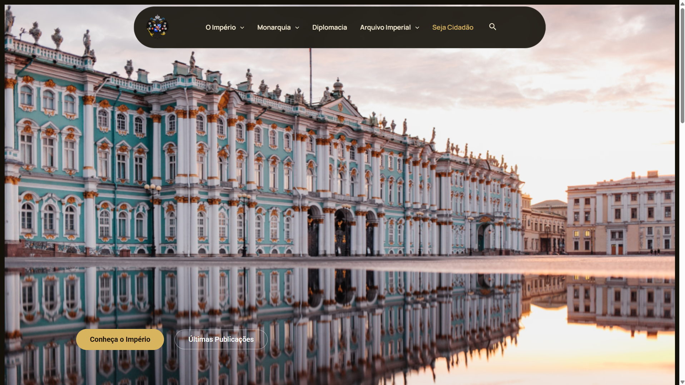

# Império Russo — site em WordPress

Site de uma **micronação** (projeto de simulação de Estado organizado como monarquia imperial), criado primeiro em HTML puro e depois migrado para **WordPress**, para que o responsável consiga editar textos, fotos e publicar decretos e notícias sozinho, pelo painel, sem mexer em código.

**Site no ar:** https://imperiorusso.org



## O problema

O site começou como um projeto estático em HTML, CSS e JavaScript. Funcionava, mas toda mudança de texto ou nova publicação dependia de alguém editar o código. O cliente não é técnico e precisava de autonomia para:

- editar textos e fotos de todas as páginas;
- publicar decretos e notícias, que entram sozinhos na Home e numa página de arquivo;
- manter um menu organizado por categorias (Arquivo Imperial, Atos do Imperador, Tratados e Convenções...);
- receber pedidos de passaporte de novos cidadãos por um formulário na Home.

## O que eu fiz

1. **Migração do HTML para WordPress.** Preservei a identidade visual original: tema escuro com detalhes dourados, cabeçalho flutuante com efeito de vidro e tipografia com serifa para os títulos.
2. **Tema próprio ("Império").** Primeira versão, escrita em PHP, que cria sozinha as páginas, categorias e o menu, tem carrossel de posts na Home e formulário somente na Home. O código está na pasta [`tema-imperio`](tema-imperio).
3. **Troca para o tema Astra.** O editor do tema próprio se mostrou difícil para o cliente, então a versão publicada usa o tema **Astra** (gratuito), com personalização feita pelo Personalizar do WordPress e por CSS adicional.
4. **Home montada com blocos.** Topo com foto de fundo e botões, seção de últimas publicações e formulário de passaporte no final da Home.
5. **Menu em vários níveis**, montado pelo cliente em Aparência > Menus, com versão compacta para celular.
6. **Cabeçalho de vidro** (`backdrop-filter`) e menu com espaçamento ajustado por CSS, mais lupa de pesquisa.


## Tecnologias

- WordPress e tema Astra
- Tema próprio em PHP, HTML e CSS (`tema-imperio`)
- Plugins: Spectra (blocos), Elementor, WPForms (formulário), WPCode, Jetpack, Use Any Font (fontes personalizadas)
- CSS3 (variáveis, `backdrop-filter`, layout responsivo, media queries)

## Decisões e desafios

- **Autonomia do cliente primeiro.** O requisito principal era que um usuário não técnico administrasse tudo. Por isso troquei o tema feito à mão por um tema consolidado com editor visual.
- **Formulário só na Home.** O formulário de passaporte foi restrito à página inicial, e não às páginas internas.
- **Plano gratuito.** Escolhi ferramentas gratuitas e descartei opções em que o carrossel de posts exigia versão paga.
- **Compatibilidade entre editores.** A Home e algumas páginas vieram com Elementor, enquanto o resto usa o editor de blocos. Foi preciso conferir cada página depois da troca de tema.
- **Responsividade.** Ajustei o menu de celular (que estava mostrando a lista automática de páginas) e as cores do painel para manter a leitura.

## Estrutura do repositório

```
imperio-russo-wordpress/
├── README.md
├── tema-imperio/     # tema próprio (primeira versão): style.css, functions.php, header.php, footer.php,
│                     # front-page.php, page.php, single.php, index.php, card.php
└── prints/           # capturas de tela do site
```

O tema Astra não está neste repositório porque não é de minha autoria; ele pode ser instalado pelo painel do WordPress (Aparência > Temas > Adicionar novo).

## Como usar o tema próprio

1. Compacte a pasta `tema-imperio` em um `.zip`.
2. No painel do WordPress, vá em **Aparência > Temas > Adicionar novo > Enviar tema** e envie o arquivo.
3. Ative o tema. Ele cria as páginas, categorias e o menu inicial.

## Autor

**Lucas Nascimento** — Desenvolvedor & Analista de Dados
GitHub: [nnascimento-l](https://github.com/nnascimento-l)
